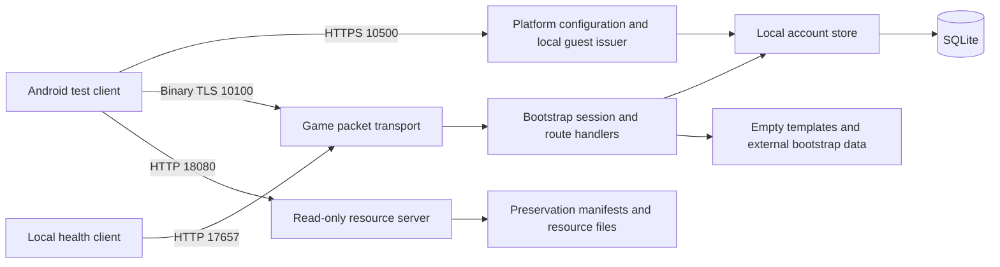

# How it works

The client needs three distinct services. The platform service provides local
connection settings and locally issued credentials. The binary game service
returns account and initial game responses. The CDN reads preserved content from
disk. The server code does not make outbound network connections.

## Package map

| Module | Responsibility |
|---|---|
| `server.py` | Asyncio listeners, connection lifecycle, counters and status |
| `protocol.py` | Packet construction, frame encoding, response framing and Pong |
| `packet_reader.py` | Bounded frame decoding, checksums, raw LZ4 and packet parsing |
| `platform.py` | Platform HTTPS route bodies and local endpoint configuration |
| `bootstrap.py` | Connection sign-in state, guest identity/credentials and game API dispatch |
| `account.py` | SQLite profile, campaign receipts, prologue completion, migrations and attendance claims |
| `campaign.py` | First chapter identifiers, stage flags, reward constants and native progress encoding |
| `missions.py` | Supported beginner reward IDs and amounts from the pinned client catalog |
| `beginner.py` | Eligibility, atomic multi-mission rewards, claim bits and persistent retry receipts |
| `challenges.py` | Catalog challenge conditions, contiguous next/all-step claims and atomic step/request receipts |
| `hero_knowledge.py` | Initial acquisition knowledge for untrained base heroes, asset rewards and atomic hero/request receipts |
| `items.py` | Shared persistent inventory-row defaults |
| `stamina_purchase.py` | Catalog prices, stored-stamina limits, UTC daily purchase quota and atomic payment receipts |
| `festival_shop.py` | Local shop exclusions, catalog point prices and atomic asset/stackable redemptions |
| `admin.py`, `admin_festival.py` | Exclusive audited grants of gems and active-season Festival points |
| `tutorials.py` | Passive help IDs and post-Inn acknowledgment IDs from the pinned client catalog |
| `lobby.py` | Empty initial lobby/catalog read responses with correct body encoding |
| `reference.py` | External reference input, built-in templates and local certificate defaults |
| `assets.py` | Separate manifest-backed HTTP resource server |
| `probe.py`, `demo.py`, `validation.py` | Developer checks, synthetic demo and regression runner |

## Account lifecycle

1. The database creates one local UUID and an empty account template.
2. Platform sign-in/sign-up issues credentials from this instance's own signing
   key. Incoming provider tokens are shape-checked and discarded, not forwarded.
3. Game sign-in reports `NeedPrologue=true` until the prologue selection is saved.
4. The client creates its temporary prologue party from its embedded data.
5. `/auth/sign-up/v2` saves the name, avatar, voice selection and starting weapons,
   creates one knight, and returns the local account identity.
6. A later sign-in reports `NeedPrologue=false`; account reads recover the stored
   character. Repeating the identical completion does not duplicate equipment.

All sessions map to this one local account. The credential implementation is an
interoperability mechanism, not multiuser authentication or authorization.

## Persistence

The backend owns one SQLite connection on the asyncio event-loop thread. Profile
JSON, prologue selection, local identity/secrets, attendance claims, the active campaign stage and diagnostic
counters are stored in separate tables. Successful mutations use transactions.
Known schema migrations repair only the specific older prototype state they
recognize; unknown legacy edits are not silently overwritten.

Attendance uses a UTC date ledger. Repeating a claim on the same date returns the
saved state. A catalog reward must resolve entirely to supported asset balances
before the transaction changes the profile or records the claim. Item/random
rewards are rejected until their inventory behavior exists.

## Incomplete operations

Unknown game routes close the connection instead of returning invented success.
Unknown platform routes return HTTP 503. The client can show a connection error
at these boundaries. Initial empty read responses do not imply working shops,
guilds, summoning, missions, progression or battle validation.

The first chapter query returns an empty progress string for each of its seven
stages. The native client constructs a `StageProgress` per entry and accepts an
empty string as initialized empty stores. An absent entry instead produces a null
progress object and blocks the entry UI.

The original entry fallback covers Inn. An optional story catalog provides each
supported stage's clear prerequisites, stamina cost and quest IDs. Eligible
successors receive only the opened flag; the first entry consumes the configured
stamina, from charged stamina first and reserve second, and sets the unlocked
flag. Reentry does not charge again. The profile and active-stage switch commit
together, so a failed write cannot leave spent stamina with the old/new session
out of sync. Stage progress is queried by stage ID, preserving separate stores.
Chapter reads include the latest user progress to refresh newly earned openings.
Quest 27 and its observed early checkpoints are
saved in `UserProgress`; neither operation marks the phase cleared. The native
quest callbacks update their own in-memory quest objects, so their responses do
not send a second copy of `UserProgress`.

Other configured stages accept only their catalog quest IDs for registration.
The early main-quest checkpoint handler can operate in the active configured
stage, retaining its sequential/no-reward scope. These shared entry/quest
operations do not implement a later stage's combat, pickups or completion rules.

Purple coins, star pieces, named items and known defeated monster handles have per-stage
receipts. Their native progress stores are encoded as version 2: a store count,
category IDs, byte-indexed boolean bitmaps, signed 32-bit integer overrides and
a trailing `StonePieces` byte (currently zero). Repeated or overlapping requests do not repeat grants.
Named item receipts retain their inventory IDs across restart. The monster drop
rule is provisional; see [status](status.md) before relying on its economy.

The first phase's clear exit requires an active stage, quest checkpoint 4 and the
glove chest receipt. A transaction saves its cleared flag, completion telemetry
and one 50-free-gem grade claim, then removes the active stage session. Retrying
the same completion after restart returns the saved progress without another
reward. This phase has no configured `StageSpec.Rewards` or `FailRewards`; its
grade reward is separate. The observed post-clear tutorial ID 200 is persisted
once and returned in `UserProgress` so the client's resource handler sees it.
Additional configured clear exits use their own external completion catalog.
They require saved encounter markers in an active unlocked stage and commit the
clear receipt, telemetry, earned openings and session cleanup atomically. Retry
does not remove a later active stage. This path preserves balances and quests;
additional clear rewards are not inferred from Inn's grade reward.
The world-map acknowledgment 2019 also requires Inn cleared. Thirty-two passive
help popups, including summons help 1003 and mission-book help 1007, can be
recorded after local account creation independently of campaign or training.
These catalog entries have no start/move scene, actions or start/end conditions.
Only requested IDs are saved, with no system unlocks or rewards. Mixed tutorial
batches are validated before any acknowledgment is saved.

An optional tutorial catalog supplies the remaining known IDs. Their completion
markers can be stored after Inn is cleared. This records the client's UI state;
the handler does not execute tutorial actions, award items or alter quest/stage
state. Gameplay operations retain their own validation and persistence rules.
Unknown IDs and malformed catalogs are rejected before flags change.

The next tutorial sends `/user/add-character-experience` with a character-ID
dictionary of experience deltas. With an external training catalog, owned knights
without limit breaks or blessings can reach any listed level within the saved
story cap. Batches share one experience balance and are validated before any
mutation. One transaction saves the character totals, balance, spending counter
and request receipt. Costs are data, not individual allowlisted amounts.

Request receipts use the packet sequence ID within a persisted client request
epoch. `Reconnect: true` retains that epoch; a fresh sign-in starts another, so
a new request can legitimately spend the same amount or reuse a sequence ID.
Replays return current state without spending again. After a fresh session, a
matching completed request is recognized only when its proposed new target is
invalid; this cannot infer every ambiguous replay across a fresh client launch.
Without the catalog, the original one-time 37-point tutorial remains available.

Beginner mission claims currently accept Inn (0), knight level 2 (1) or spending
ten stamina (9), one
distinct mission per batch. Prerequisites are checked against saved clear/training
state or the sum of charged/reserve `Spent` counters. The transaction updates
asset balances, shared ticket/material inventory,
the base64 `GuideClaimed` bit array and a frozen reward receipt. A retry reuses
the original item IDs and reward notice while returning current account state.
Other missions and mixed batches remain unsupported.

The first collect-hero challenge uses a separate `(group_id, step)` reward
receipt and the integer `ChallengeClaimed` map. Only group 200's first step is
implemented for the saved one-knight account. Its transaction records step 1 and
50 free gems together; retries reuse the original reward notice. Later steps and
the all-step route require their own progression/retry contracts.

`/ad/init-inbox` is a parameterless compatibility read. Its callbacks open the
inbox while the global resource handler applies the returned saved `UserRecord`.
It preserves the existing local ad state and does not create rewards or implement
ad viewing/claims.

`/summon/enter` returns the empty local pickup catalog's `Checksum` and
`IsActiveEvent=false`. The scene loader compares these values before deciding
whether to reload its catalog. The checksum matches `/summon/on-event`; entry
does not modify the account or implement the actual summoning operations.

The automatic `/user/exchange-summon-pickup-ticket` check returns current
`UserShop` plus empty
`ExchangeSummonPickUpTickets` and `ExchangeCollaborationPickUpTickets` dictionaries.
Regular/selectable inventory tickets are a separate resource and remain intact.
For imported accounts, the explicit local preservation policy retains valid
pickup/collaboration coupon counters, including positive amounts, without
processing conversions or expiration. No currencies, items, shop revision or
coupon amounts are changed. This permits the automatic scene-entry check while
actual redemption remains unsupported. Fresh local accounts still require empty
coupon maps. Malformed counters and unexpected parameters are rejected.

The contents-book loader queries `/coop-expedition/enter` and then `/rift/enter`
before loading its tabs. The former accepts exactly a Boolean `IsPartial`; the
latter accepts an empty body. Both require sign-in and perform no database writes.
Rift entry returns the current full `UserProgress`, preserving captured evolution
reward selections without daily refreshes. Cooperative entry returns a full
`UserCoopExpedition` local placeholder with empty stage/narrative/reward state,
zero counters and the captured `CoopExpeditionSlots` presets when available.
That separate cooperative progress was not captured or recovered from the
official account. The placeholder is not saved over the imported profile and
does not enable matching, battles, clears or rewards. Request builders, client
load order and model fields were inspected statically; the original response
was not captured. After the backend reload, both APK reads succeeded and the
owner reported recovery using Reconnect without closing the game. This does not
establish working mode gameplay.

`/tower-infinity/enter` is another authenticated, parameterless read. Its native
entry callback reads a top-level `TowerInfinity` object and assigns it to the
client's progress before transitioning. The handler returns the current saved
`UserProgress.TowerInfinity` object under that exact key, retaining signed floors
and legacy `Formation` without migrating presets. Missing or invalid saved floor
data is rejected without repair. It performs no writes, floor advancement or
rewards. Formation changes and stage end remain unsupported; stage loading has
the separate guarded trial described below.
The request builder, callback and legacy formation fallback were inspected
statically; the original response was not captured. The APK subsequently completed
entry and reached the ranking query with the full saved profile unchanged.

`/tower-infinity/get-rankings` is an authenticated, parameterless read returning
`{"Rankings":[]}`. Its native callback reads that exact key, and the list view
uses the list's count. An empty array is therefore required rather than a missing
or null list. This is an empty local leaderboard with no copied official entries,
invented self-rank, rewards or database writes. Unexpected parameters reject.
The separate personal-ranking query remains unsupported. After reload, health
recorded a successful APK ranking query, and the owner proceeded to stage entry.

`/tower-infinity/start-stage` accepts exactly integer `floor` and `presetId`.
Its native success callback ignores the response body and starts the existing
client floor spec with the selected preset. The experimental handler validates
sign-in, completed prologue, a matching external floor catalog, the local
saved-floor limit and a preserved party preset with owned characters/equipment
before returning `{}`. It writes no attempt or profile state and grants no
rewards. Repeating or reconnecting the request therefore spends nothing and
does not advance progress. Stage results and formation changes remain rejected.
This enables a loading trial, not saved Orbital combat progression. The original
start response was not captured. The APK subsequently loaded the phase, and the
owner confirmed defeat followed by return to the menu. No end-stage request was
observed in that trial; the full profile and draw receipts remained unchanged.
Victory, saved progression and rewards are still unverified and unimplemented.

`/preset/set-selected-preset` accepts exactly integer `PresetId`. The native enum
uses `InfiniteTower = 4` with width-100 ID ranges. The implemented scope is existing
captured Orbital presets in `[400,500)`, validated by the same owned-party helper
as phase entry. One transaction changes only `User.SelectedPresetId.InfiniteTower`
and `User.Cas`, then stores a session-epoch/sequence request receipt. No-op choices
leave the revision intact; retries return current `User` without undoing later
choices. Reusing a request identity for another ID rejects, and a failed receipt
write rolls back the profile update. Preset definitions, current party, character
progression/equipment and inventory remain unchanged. Creating/deleting presets,
other modes and formation/result writes are separate unsupported contracts.
The original response was not captured. The APK selection subsequently succeeded;
its saved receipt, pointer and revision matched, with unrelated state preserved.

The following `/user/charge-stamina` failure was a separate parameterless natural
recharge request. Its local policy mirrors the native client arithmetic: below
`MaxStaminaDefault + MaxAdj`, credit due ticks from `NextCharge` at the configured
minute interval, clamp the balance and advance the saved anchor by elapsed ticks.
One transaction stores the charged amount, next anchor and incremented account
revision. The persisted anchor makes repeated requests idempotent for already
credited ticks, while later requests can earn newly elapsed ticks. Future/null
anchors and full/over-cap balances are no-ops. Seven-digit .NET fractions are
preserved without granting an early tick. The response returns current `User`;
reserve stamina, spending, gems, purchase counters and presets remain unchanged.
The original official response was not captured. The APK recharge subsequently
succeeded; the saved balance/timer and later selection revisions matched their
expected changes, with unrelated profile and captured reads preserved.

`/preset/set-presets` edits one existing Orbital party with `PartyPreset` and a
Boolean `SetSelected`. The native party serializer includes ID/name/order/members;
nullable character equipment fields are omitted and normalize to unequipped
slots. The handler validates the existing mode ID, preserved order, bounded name,
distinct owned members and owned equipment. Empty nonselected teams can be stored,
but selection/entry still require a nonempty team. It returns the full current
`UserPartyPreset2` group and current `User`, retaining other presets.

`party_preset_state` holds the current group; the original imported startup seed
remains unchanged. Preserved reads overlay that group so later menus, selection
and stage loading resolve edits after reopening. The group revision increments
only for a changed definition. An optional changed selection increments `User.Cas`;
the profile's hero/equipment/inventory fields remain unchanged. Group, optional
selection and `preset_edit_requests` receipt commit together. Retries return
current state and cannot restore an earlier definition. Creation, deletion,
reordering and other mode edits remain unsupported. APK save retry is pending.

## Resource boundaries

The CDN accepts only files listed under `resources/files/` in preservation
manifests. URL aliases normalize the known version prefixes; later roots overlay
earlier ones. It supports ETags, conditional reads, HEAD and one explicit byte
range. It does not decrypt the content, download missing files, or compare every
file's bytes to its manifest SHA-256 while serving.

Private emulator routing, rootfs provisioning and SDK cache restoration are
installation-specific tooling outside this repository. See
[client integration](client-integration.md) for how the prepared test differed
from simply starting this Python backend.
