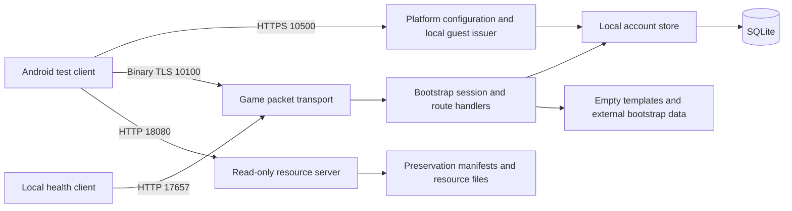

# How it works

The client needs three distinct services. The platform service provides local
connection settings and locally issued credentials. The binary game service
returns account and initial game responses. The CDN reads preserved content from
disk. The server code does not make outbound network connections.

## Static data after a restart

When the game checks for updated data, the backend evaluates the current calendar,
mode selections, account-specific item definitions and lobby notice. It stores
each prepared overlay under `<data-dir>/static-cache/`, with one file per
transformation. An entry matches the exact input bytes, transformation settings
and backend implementation. The stored response bytes and client checksum are
verified together before reuse. The first request prepares missing entries.
An unreadable or damaged cache entry is rebuilt on demand. The cache directory
is disposable and can be excluded from save backups.

The standard-library reader handles static data on its own. Installing the
optional `static-data` extra enables native LZ4 decompression after block
validation. Older supported block layouts use the Python reader. The encoder
produces the same on-wire data with either installation.

When building the lobby settings report, the mode readers share one read-only
index of the verified stock tables. Its key is the full compressed catalog.
Custom Raid lineups use their own published tables. Each report still reads
the current mode settings and account progress.

On first opening the web inventory, the panel uses the same verified item
definitions for display and for the equipment picker. The picker follows the
stock evolution chains even when the save has local item variants.

## Package map

The backend lives in [guardian_tales/](../guardian_tales/). Use the package that
owns a feature when writing new code. For example, import `ReferenceData` from
`guardian_tales.content.reference`. Existing code can import the same class
from `guardian_tales.reference`.
Both `python -m guardian_tales` and the installed `gt-local` command expose the
same subcommands.

| Package | What belongs here |
|---|---|
| [runtime](../guardian_tales/runtime/) | Game and platform listeners, packet framing, sign-in dispatch, service control, Android bridge, TLS certificates and developer commands |
| [accounts](../guardian_tales/accounts/) | SQLite account persistence, snapshot import, profile cards, portraits and badges |
| [administration](../guardian_tales/administration/) | Audited grants, optional test items, Andras trial and Head Hunter |
| [content](../guardian_tales/content/) | Content packs, reference data, prepared static-data cache and the manifest-backed HTTP resource server |
| [campaigns](../guardian_tales/campaigns/) | Story stages, interactions, unlocks, quest rewards and campaign completion |
| [heroes](../guardian_tales/heroes/) | Hero equipment slots, evolution, Myth, awakening, blessings, resets and training |
| [inventory](../guardian_tales/inventory/) | Inventory capacity, item protection and removal, weapons, relics, jewels and merch |
| [teams](../guardian_tales/teams/) | Party members, formations, presets and slot ordering |
| [rewards](../guardian_tales/rewards/) | Mission claims, challenges, hero knowledge, passes, festivals, stamina and attendance |
| [summons](../guardian_tales/summons/) | Hero and weapon draws, wishlists, selection and payments |
| [settlement](../guardian_tales/settlement/) | Village activities, basecamp harvest and guardian mastery |
| [lobby_ui](../guardian_tales/lobby_ui/) | Lobby reads, notices, artwork and the active configuration report |
| [modes](../guardian_tales/modes/) | Classic Co-op and Colosseum, plus dedicated packages for [guild modes](../guardian_tales/modes/guild/) (Raid, DKA and Guild War), [Expedition](../guardian_tales/modes/expedition/), [Kama-ZONE](../guardian_tales/modes/kamazone/), [Orbital Lift](../guardian_tales/modes/orbital/) and [Tetis](../guardian_tales/modes/tetis/) |

The web dashboard uses [web_panel](../guardian_tales/web_panel/) for game modes,
[inventory_panel](../guardian_tales/inventory_panel/) for the inventory editor
and [panel_common](../guardian_tales/panel_common/) for shared HTML, HTTP
handling and artwork. Packaged account templates and scripts live in
[templates/](../guardian_tales/templates/).

## Account lifecycle

1. The database creates one local UUID and an empty account template.
2. Platform sign-in/sign-up issues credentials from this instance's own signing
   key. Incoming provider tokens are shape-checked and discarded, not forwarded.
3. Game sign-in reports `NeedPrologue=true` until the prologue selection is saved.
4. The client creates its temporary prologue party from its embedded data.
5. `/auth/sign-up/v2` saves the name, avatar, voice selection and starting weapons,
   creates one knight, and returns the local account identity.
6. A later sign-in reports `NeedPrologue=false`; account reads recover the stored
   character. Repeating the identical completion does not duplicate equipment.

All sessions map to this one local account. The credential implementation is an
interoperability mechanism, not multiuser authentication or authorization.

## Persistence

The backend owns one SQLite connection on the asyncio event-loop thread. Profile
JSON, prologue selection, local identity/secrets, attendance claims, the active campaign stage and diagnostic
counters are stored in separate tables. Successful mutations use transactions.
Known schema migrations repair only the specific older prototype state they
recognize; unknown legacy edits are not silently overwritten.

Attendance uses a UTC date ledger. Repeating a claim on the same date returns the
saved state. A catalog reward must resolve entirely to supported asset balances
before the transaction changes the profile or records the claim. Item/random
rewards are rejected until their inventory behavior exists.

## Incomplete operations

Unknown game routes close the connection instead of returning invented success.
Unknown platform routes return HTTP 503. The client can show a connection error
at these boundaries. Initial empty read responses do not imply working shops,
guilds, summoning, missions, progression or battle validation.

The first chapter query returns an empty progress string for each of its seven
stages. The native client constructs a `StageProgress` per entry and accepts an
empty string as initialized empty stores. An absent entry instead produces a null
progress object and blocks the entry UI.

The original entry fallback covers Inn. An optional story catalog provides each
supported stage's clear prerequisites, stamina cost and quest IDs. Eligible
successors receive only the opened flag; the first entry consumes the configured
stamina, from charged stamina first and reserve second, and sets the unlocked
flag. Reentry does not charge again. The profile and active-stage switch commit
together, so a failed write cannot leave spent stamina with the old/new session
out of sync. Stage progress is queried by stage ID, preserving separate stores.
Chapter reads include the latest user progress to refresh newly earned openings.
Quest 27 and its observed early checkpoints are
saved in `UserProgress`; neither operation marks the phase cleared. The native
quest callbacks update their own in-memory quest objects, so their responses do
not send a second copy of `UserProgress`.

Other configured stages accept only their catalog quest IDs for registration.
The early main-quest checkpoint handler can operate in the active configured
stage, retaining its sequential/no-reward scope. These shared entry/quest
operations do not implement a later stage's combat, pickups or completion rules.

Purple coins, star pieces, named items and known defeated monster handles have per-stage
receipts. Their native progress stores are encoded as version 2: a store count,
category IDs, byte-indexed boolean bitmaps, signed 32-bit integer overrides and
a trailing `StonePieces` byte (currently zero). Repeated or overlapping requests do not repeat grants.
Named item receipts retain their inventory IDs across restart. The monster drop
rule is provisional; see [status](status.md) before relying on its economy.

The first phase's clear exit requires an active stage, quest checkpoint 4 and the
glove chest receipt. A transaction saves its cleared flag, completion telemetry
and one 50-free-gem grade claim, then removes the active stage session. Retrying
the same completion after restart returns the saved progress without another
reward. This phase has no configured `StageSpec.Rewards` or `FailRewards`; its
grade reward is separate. The observed post-clear tutorial ID 200 is persisted
once and returned in `UserProgress` so the client's resource handler sees it.
Additional configured clear exits use their own external completion catalog.
They require saved encounter markers in an active unlocked stage and commit the
clear receipt, telemetry, earned openings and session cleanup atomically. Retry
does not remove a later active stage. This path preserves balances and quests;
additional clear rewards are not inferred from Inn's grade reward.
The world-map acknowledgment 2019 also requires Inn cleared. Thirty-two passive
help popups, including summons help 1003 and mission-book help 1007, can be
recorded after local account creation independently of campaign or training.
These catalog entries have no start/move scene, actions or start/end conditions.
Only requested IDs are saved, with no system unlocks or rewards. Mixed tutorial
batches are validated before any acknowledgment is saved.

An optional tutorial catalog supplies the remaining known IDs. Their completion
markers can be stored after Inn is cleared. This records the client's UI state;
the handler does not execute tutorial actions, award items or alter quest/stage
state. Gameplay operations retain their own validation and persistence rules.
Unknown IDs and malformed catalogs are rejected before flags change.

The next tutorial sends `/user/add-character-experience` with a character-ID
dictionary of experience deltas. With an external training catalog, owned knights
without limit breaks or blessings can reach any listed level within the saved
story cap. Batches share one experience balance and are validated before any
mutation. One transaction saves the character totals, balance, spending counter
and request receipt. Costs are data, not individual allowlisted amounts.

Request receipts use the packet sequence ID within a persisted client request
epoch. `Reconnect: true` retains that epoch; a fresh sign-in starts another, so
a new request can legitimately spend the same amount or reuse a sequence ID.
Replays return current state without spending again. After a fresh session, a
matching completed request is recognized only when its proposed new target is
invalid; this cannot infer every ambiguous replay across a fresh client launch.

Imported accounts use a separate, opt-in free training implementation and
`imported_character_training_requests` receipts. Matching external public data
supplies the hero IDs, myth variants, XP thresholds and the story/break/blessing/
myth cap calculation. Positive deltas within that cap update owned hero XP and
the applied-experience record without touching any asset amount or spending.
The profile and receipt commit together; a replay returns current resources,
while a new identity may legitimately apply the same delta again. No cost-based
retry inference or tutorial marker is shared with paid knight training. Exact
`Experiences` requests are admitted by the imported-account mutation guard only
into this separately validated policy; missing configuration still rejects.
Without the catalog, the original one-time 37-point tutorial remains available.

Beginner mission claims currently accept Inn (0), knight level 2 (1) or spending
ten stamina (9), one
distinct mission per batch. Prerequisites are checked against saved clear/training
state or the sum of charged/reserve `Spent` counters. The transaction updates
asset balances, shared ticket/material inventory,
the base64 `GuideClaimed` bit array and a frozen reward receipt. A retry reuses
the original item IDs and reward notice while returning current account state.
Other missions and mixed batches remain unsupported.

Challenge claims use `(group_id, step)` reward receipts and the integer
`ChallengeClaimed` map. The no-catalog fresh-account fallback grants only group
200's first step for the saved knight. The fresh catalog extends this to
configured hero-count, draw-count and lifetime-gold conditions. Imported
accounts require a separate pinned-client catalog with verified native progress
types and reward storage. `imported_challenge_baselines` records existing
official claim markers without paying their rewards again. Later local claims
must have contiguous receipts above that baseline, never an implicit rebase.
The next-step route grants one eligible step per group; the all-step route grants
all consecutively earned steps based on the same saved progress snapshot.
New assets, stackables or unowned single cosmetics, claim markers, inventory
counter, revisions, baselines and request receipts commit atomically. Replays
return frozen notices and current resources; other mission families remain
separate contracts. See [external policy](reference-data.md#challenge-reward-steps).

`/ad/init-inbox` is a parameterless compatibility read. Its callbacks open the
inbox while the global resource handler applies the returned saved `UserRecord`.
It preserves the existing local ad state and does not create rewards or implement
ad viewing/claims.

`/summon/enter` returns the empty local pickup catalog's `Checksum` and
`IsActiveEvent=false`. The scene loader compares these values before deciding
whether to reload its catalog. The checksum matches `/summon/on-event`; entry
does not modify the account or implement the actual summoning operations.

The automatic `/user/exchange-summon-pickup-ticket` check returns current
`UserShop` plus empty
`ExchangeSummonPickUpTickets` and `ExchangeCollaborationPickUpTickets` dictionaries.
Regular/selectable inventory tickets are a separate resource and remain intact.
For imported accounts, the explicit local preservation policy retains valid
pickup/collaboration coupon counters, including positive amounts, without
processing conversions or expiration. No currencies, items, shop revision or
coupon amounts are changed. This permits the automatic scene-entry check while
actual redemption remains unsupported. Fresh local accounts still require empty
coupon maps. Malformed counters and unexpected parameters are rejected.

The contents-book loader queries `/coop-expedition/enter` and then `/rift/enter`
before loading its tabs. The former accepts exactly a Boolean `IsPartial`; the
latter accepts an empty body. Both require sign-in and perform no database writes.
Rift entry returns the current full `UserProgress`, preserving captured evolution
reward selections without daily refreshes. Cooperative entry returns a full
`UserCoopExpedition` local placeholder with empty stage/narrative/reward state,
zero counters and the captured `CoopExpeditionSlots` presets when available.
That separate cooperative progress was not captured or recovered from the
official account. The placeholder is not saved over the imported profile and
does not enable matching, battles, clears or rewards. Request builders, client
load order and model fields were inspected statically; the original response
was not captured. After the backend reload, both APK reads succeeded and the
owner reported recovery using Reconnect without closing the game. This does not
establish working mode gameplay.

`/tower-infinity/enter` is another authenticated, parameterless read. Its native
entry callback reads a top-level `TowerInfinity` object and assigns it to the
client's progress before transitioning. The handler returns the current saved
`UserProgress.TowerInfinity` object under that exact key, retaining signed floors
and legacy `Formation` without migrating presets. Missing or invalid saved floor
data is rejected without repair. It performs no writes, floor advancement or
rewards. Formation changes and stage end remain unsupported; stage loading has
the separate guarded trial described below.
The request builder, callback and legacy formation fallback were inspected
statically; the original response was not captured. The APK subsequently completed
entry and reached the ranking query with the full saved profile unchanged.

`/tower-infinity/get-rankings` is an authenticated, parameterless read returning
`{"Rankings":[]}`. Its native callback reads that exact key, and the list view
uses the list's count. An empty array is therefore required rather than a missing
or null list. This is an empty local leaderboard with no copied official entries,
invented self-rank, rewards or database writes. Unexpected parameters reject.
The separate personal-ranking query remains unsupported. After reload, health
recorded a successful APK ranking query, and the owner proceeded to stage entry.

`/tower-infinity/start-stage` accepts exactly integer `floor` and `presetId`.
Its native success callback ignores the response body and starts the existing
client floor spec with the selected preset. The experimental handler validates
sign-in, completed prologue, a matching external floor catalog, the local
saved-floor limit and a preserved party preset with owned characters/equipment
before returning `{}`. It writes no attempt or profile state and grants no
rewards. Repeating or reconnecting the request therefore spends nothing and
does not advance progress. Formation saves and opt-in progress-only results use
separate handlers. The original
start response was not captured. The APK subsequently loaded the phase, and the
owner confirmed defeat followed by return to the menu. No end-stage request was
observed in that trial; the full profile and draw receipts remained unchanged.
That loading trial did not establish victory progression or rewards. The later
opt-in no-reward completion contract is documented in the
[reference guide](reference-data.md).

`/tower-infinity/save-formation` is a separate authenticated deployment mutation.
The 3.57.0 client sends four ordered `Positions` on a 20-cell grid. Only the
legacy `UserProgress.TowerInfinity.Formation.Positions` and progress revision
change, with an atomic retry receipt. The native success callback copies those
positions locally. Current `UserProgress` is also returned; delayed retries
cannot overwrite later saved deployments or floor progression. Other formation
maps, party/preset definitions, heroes/equipment and rewards are untouched.

`/preset/set-selected-preset` accepts exactly integer `PresetId`. The native enum
uses width-100 ID ranges: `InfiniteTower` is `[400,500)`, and the shared
`GuildRaidAndConquest` selection uses `[700,800)`. Only existing saved definitions
with owned heroes/equipment are selectable. One transaction changes only that
mode's `User.SelectedPresetId` field and `User.Cas`, then stores a
session-epoch/sequence request receipt. No-op choices
leave the revision intact; retries return current `User` without undoing later
choices. Reusing a request identity for another ID rejects, and a failed receipt
write rolls back the profile update. Preset definitions, current party, character
progression/equipment, independent mode pointers and inventory remain unchanged.
Other selection groups and formation/result writes are separate unsupported
contracts; Orbital editing/creation/deletion
are described below.
The original response was not captured. The APK selection subsequently succeeded;
its saved receipt, pointer and revision matched, with unrelated state preserved.
Raid selection was tested through the protocol against an in-memory clone of
the actual account; its first post-fix APK change remains unverified.

The native DKA preset type is 13 with seven slots (1300–1306) and an independent
`GuildPunchKing` selection. Apply uses the shared party preset save transaction
for both existing and new teams. The native seven-entry order array addresses
these slots by ID. Deleting the selected team clears the DKA pointer.

All preset mutations and their receipt replays now return a compact `User`
resource containing only `Id`, `Cas` and the complete `SelectedPresetId` map.
Native `NetResMediator.HasMyResource` requires the owner ID. `User.Apply` retains
absent scalar fields and guards hero/inventory parsing on property presence;
its selected-mode map uses replacement semantics, so all mode pointers are
included. The full current `UserPartyPreset2` group is still returned for save,
creation and deletion, since the client replaces the preset dictionary. The
saved profile and transactions are unchanged. This avoids transferring and
reprocessing unrelated heroes/equipment on each small preset action. Cloned
actual-account response/encoding measurements passed; APK latency and compact
resource handling remain pending reload and reconnect.

The following `/user/charge-stamina` failure was a separate parameterless natural
recharge request. Its local policy mirrors the native client arithmetic: below
`MaxStaminaDefault + MaxAdj`, credit due ticks from `NextCharge` at the configured
minute interval, clamp the balance and advance the saved anchor by elapsed ticks.
One transaction stores the charged amount, next anchor and incremented account
revision. The persisted anchor makes repeated requests idempotent for already
credited ticks, while later requests can earn newly elapsed ticks. Future/null
anchors and full/over-cap balances are no-ops. Seven-digit .NET fractions are
preserved without granting an early tick. The response returns current `User`;
reserve stamina, spending, gems, purchase counters and presets remain unchanged.
The original official response was not captured. The APK recharge subsequently
succeeded; the saved balance/timer and later selection revisions matched their
expected changes, with unrelated profile and captured reads preserved.

`/preset/set-presets` edits one existing Orbital party with `PartyPreset` and a
Boolean `SetSelected`. The native party serializer includes ID/name/order/members;
nullable character equipment fields are omitted and normalize to unequipped
slots. The handler validates the existing mode ID, preserved order, bounded name,
distinct owned members and owned equipment. Empty nonselected teams can be stored,
but selection/entry still require a nonempty team. It returns the full current
`UserPartyPreset2` group and compact current `User` selection, retaining other presets.

`party_preset_state` holds the current group; the original imported startup seed
remains unchanged. Preserved reads overlay that group so later menus, selection
and stage loading resolve edits after reopening. The group revision increments
only for a changed definition. An optional changed selection increments `User.Cas`;
the profile's hero/equipment/inventory fields remain unchanged. Group, optional
selection and `preset_edit_requests` receipt commit together. Retries return
current state and cannot restore an earlier definition. The APK save succeeded;
its receipt matched the saved definition and selection with unrelated state intact.

`/preset/delete-preset` accepts one existing Orbital `PresetId`. It removes only
that definition and increments the group revision. If selected, the local policy
clears the Orbital pointer to zero and increments `User.Cas`, leaving replacement
selection to the client. The group, optional profile update and
`preset_delete_requests` receipt commit atomically. Replays return current state;
new requests for missing/ambiguous IDs reject. Full `UserPartyPreset2.Presets`
replaces the client's dictionary, as established by native model inspection.
The original official response was not captured. The APK deletion subsequently
succeeded. Its receipt and group/profile revisions
matched, with remaining definitions, unrelated profile data and earlier receipts
unchanged.

The Apply button also sends `/preset/set-presets` with `SetSelected=true`. An
observed pending request targeted an unsaved ID with `Order=999`, matching the
native empty-slot builder. A missing definition now requires a matching external
`orbital_preset_catalog.json` and a valid unused slot within its count. Native
`PresetCountS3` lookup gives five Orbital slots in the prepared data. The local
ordering policy appends after the highest saved Orbital order, retaining other
teams. Creation, optional selection and the existing edit receipt commit together.
Old save retries cannot resurrect a deleted team; old delete retries cannot remove
a recreated team. The APK subsequently persisted two creations and two deletions;
their history reproduced the current group, selection and revisions with unrelated
profile and captured reads intact. Reordering, other modes and Orbital result
writes remain unsupported.

`/lobby-village/harvest-all` collects configured gold and soul-point production
from the preserved village. Inn production uses separate saved resource clocks
and manufacture levels; ready facilities use saved `EndTime`, public effect
periods/storage and owned follower rarity/specialization bonuses. Native generic
metadata resolves the response notices as `List<ItemPlaceholder>`. The original
official response was not captured. Minimum intervals and capacity consumption
are explicit local policies described in the [experiment](official-save-experiment.md).

`village_state` holds current village clocks without changing its imported seed.
Preserved village entry overlays that state after reopening. One transaction
stores credited asset balances, village clocks, both revisions and a
`village_harvest_requests` receipt. Replays return frozen notices with current
models, even without a catalog, and never grant again. No-op receipts do not
change revisions. Full resources retain clocks; other eligible resources can
still be collected. The APK collection succeeded: its gold receipt, balance,
advanced clock and revisions matched, with full soul points and unrelated state
retained. The subsequent failure was the base-camp collection request.

`/lobby-village/harvest-basecamp` acknowledges collection from the owned,
upgraded Guardian Base Camp with an empty `AddedItems` list. An eligible
collection advances the building's `EndTime` and the village revision in the
same transaction that records the request. Replays return current user and
village state, including when the receipt predates reward-free collection.
The account profile is read-only on this route. The inventory panel can edit
mastery independently. Regular village harvests use their own clocks and rewards.

## Resource boundaries

The CDN accepts only files listed under `resources/files/` in preservation
manifests. URL aliases normalize the known version prefixes; later roots overlay
earlier ones. It supports ETags, conditional reads, HEAD and one explicit byte
range. It does not decrypt the content, download missing files, or compare every
file's bytes to its manifest SHA-256 while serving.

Private emulator routing, rootfs provisioning and SDK cache restoration are
installation-specific tooling outside this repository. See
[client integration](client-integration.md) for how the prepared test differed
from simply starting this Python backend.

## Local browser panels

Both panels use `guardian_tales/panel_common/` for loopback HTTP checks,
response headers, HTML layout rendering and sprite decoding. Each server
registers its own pages, APIs and permitted asset URLs.

### Game modes

The backend serves the mode registry in `guardian_tales/web_panel/routes.py`.
Each mode owns its Python adapter, HTML view,
stylesheet and browser module in one directory. Adapters call the same domain
functions as the CLI. The shared directory contains the page layout, navigation
styling and browser helpers. Register a mode once in `MODES` to expose its page,
navigation link, static files and GET/POST API. Register fixed artwork URLs in
`MEDIA`. Raid portraits use the frame names in the local monster table. The
shared artwork reader caches decoded sheets and requested PNGs from the
imported bosses and UI atlases.

### Inventory

Each tab has a folder under `guardian_tales/inventory_panel/static/` containing
its `view.html`, `panel.css` and `panel.js`. Equipment also owns its option
controls. The `shared/` folder holds the page layout, inventory stylesheet,
tile helpers and quantity editor. Register a tab in `inventory_panel/routes.py`
to add the page, navigation link and browser assets. This registry maps public
URLs to files, so bookmarks and browser imports are independent of disk paths.

`inventory_panel/server.py` connects the read and edit endpoints to the Python
editors. `catalog.py` loads item definitions, names and icons. The editors
use `game_save.py` for access to the working save. `preview.py` handles the
separate in-memory inventory preview.
