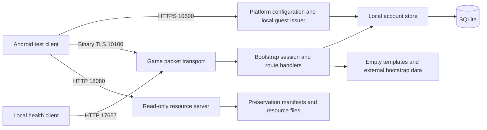

# How it works

The client needs three distinct services. The platform service provides local
connection settings and locally issued credentials. The binary game service
returns account and initial game responses. The CDN reads preserved content from
disk. The server code does not make outbound network connections.

## Package map

| Module | Responsibility |
|---|---|
| `server.py` | Asyncio listeners, connection lifecycle, counters and status |
| `protocol.py` | Packet construction, frame encoding, response framing and Pong |
| `packet_reader.py` | Bounded frame decoding, checksums, raw LZ4 and packet parsing |
| `platform.py` | Platform HTTPS route bodies and local endpoint configuration |
| `bootstrap.py` | Connection sign-in state, guest identity/credentials and game API dispatch |
| `account.py` | SQLite profile, campaign receipts, prologue completion, migrations and attendance claims |
| `campaign.py` | First chapter identifiers, stage flags, reward constants and native progress encoding |
| `lobby.py` | Empty initial lobby/catalog read responses with correct body encoding |
| `reference.py` | External reference input, built-in templates and local certificate defaults |
| `assets.py` | Separate manifest-backed HTTP resource server |
| `probe.py`, `demo.py`, `validation.py` | Developer checks, synthetic demo and regression runner |

## Account lifecycle

1. The database creates one local UUID and an empty account template.
2. Platform sign-in/sign-up issues credentials from this instance's own signing
   key. Incoming provider tokens are shape-checked and discarded, not forwarded.
3. Game sign-in reports `NeedPrologue=true` until the prologue selection is saved.
4. The client creates its temporary prologue party from its embedded data.
5. `/auth/sign-up/v2` saves the name, avatar, voice selection and starting weapons,
   creates one knight, and returns the local account identity.
6. A later sign-in reports `NeedPrologue=false`; account reads recover the stored
   character. Repeating the identical completion does not duplicate equipment.

All sessions map to this one local account. The credential implementation is an
interoperability mechanism, not multiuser authentication or authorization.

## Persistence

The backend owns one SQLite connection on the asyncio event-loop thread. Profile
JSON, prologue selection, local identity/secrets, attendance claims, the active campaign stage and diagnostic
counters are stored in separate tables. Successful mutations use transactions.
Known schema migrations repair only the specific older prototype state they
recognize; unknown legacy edits are not silently overwritten.

Attendance uses a UTC date ledger. Repeating a claim on the same date returns the
saved state. A catalog reward must resolve entirely to supported asset balances
before the transaction changes the profile or records the claim. Item/random
rewards are rejected until their inventory behavior exists.

## Incomplete operations

Unknown game routes close the connection instead of returning invented success.
Unknown platform routes return HTTP 503. The client can show a connection error
at these boundaries. Initial empty read responses do not imply working shops,
guilds, summoning, missions, progression or battle validation.

The first chapter query returns an empty progress string for each of its seven
stages. The native client constructs a `StageProgress` per entry and accepts an
empty string as initialized empty stores. An absent entry instead produces a null
progress object and blocks the entry UI.

Only the first story phase can start. Unlocking consumes 15 stamina, from charged
stamina first and reserve stamina second, and saves the opened/unlocked flags.
Retries after restart do not charge again. Quest 27 and its observed checkpoints are
saved in `UserProgress`; neither operation marks the phase cleared. The native
quest callbacks update their own in-memory quest objects, so their responses do
not send a second copy of `UserProgress`.

Purple coins, named items and known defeated monster handles have per-stage
receipts. Their native progress stores are encoded as version 2: a store count,
category IDs, byte-indexed boolean bitmaps, signed 32-bit integer overrides and
a trailing `StonePieces` byte (currently zero). Repeated or overlapping requests do not repeat grants.
Named item receipts retain their inventory IDs across restart. The monster drop
rule is provisional; see [status](status.md) before relying on its economy.

The first phase's clear exit requires an active stage, quest checkpoint 4 and the
glove chest receipt. A transaction saves its cleared flag, completion telemetry
and one 50-free-gem grade claim, then removes the active stage session. Retrying
the same completion after restart returns the saved progress without another
reward. This phase has no configured `StageSpec.Rewards` or `FailRewards`; its
grade reward is separate. The observed post-clear tutorial ID 200 is persisted
once and returned in `UserProgress` so the client's resource handler sees it.
Mission-book help tutorial 1007 is also recorded once after local account
creation, independently of campaign completion or training. Mixed tutorial
batches are validated before any acknowledgment is saved.

The next tutorial sends `/user/add-character-experience` with a character-ID
dictionary of experience deltas. Only the observed starting knight's 37-point
level 1-to-2 upgrade is supported. Its transaction subtracts the asset balance,
updates character experience and the spending counter, and records a one-time
training receipt. Retries return the current saved user; general repeated
training needs a separate retry contract before it can be supported safely.

## Resource boundaries

The CDN accepts only files listed under `resources/files/` in preservation
manifests. URL aliases normalize the known version prefixes; later roots overlay
earlier ones. It supports ETags, conditional reads, HEAD and one explicit byte
range. It does not decrypt the content, download missing files, or compare every
file's bytes to its manifest SHA-256 while serving.

Private emulator routing, rootfs provisioning and SDK cache restoration are
installation-specific tooling outside this repository. See
[client integration](client-integration.md) for how the prepared test differed
from simply starting this Python backend.
